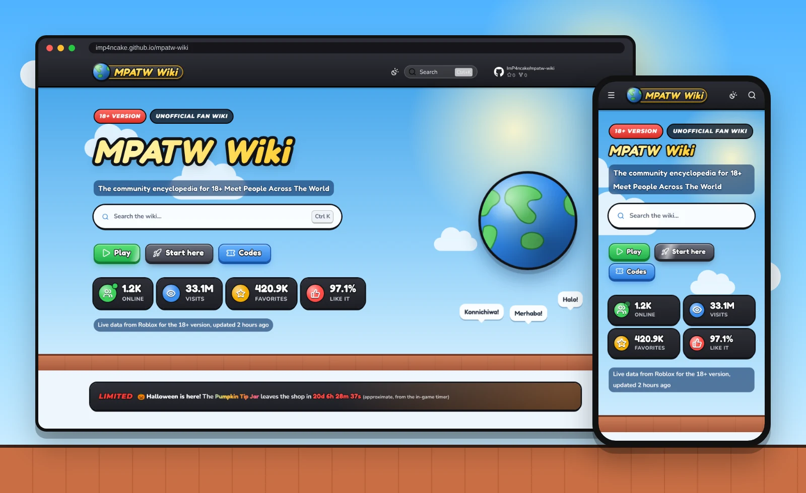
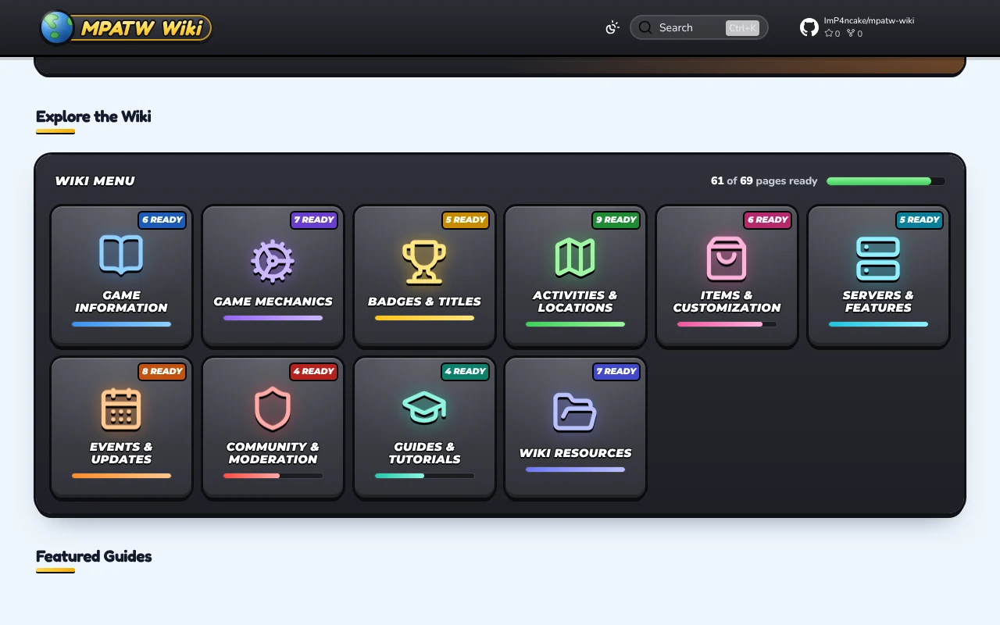
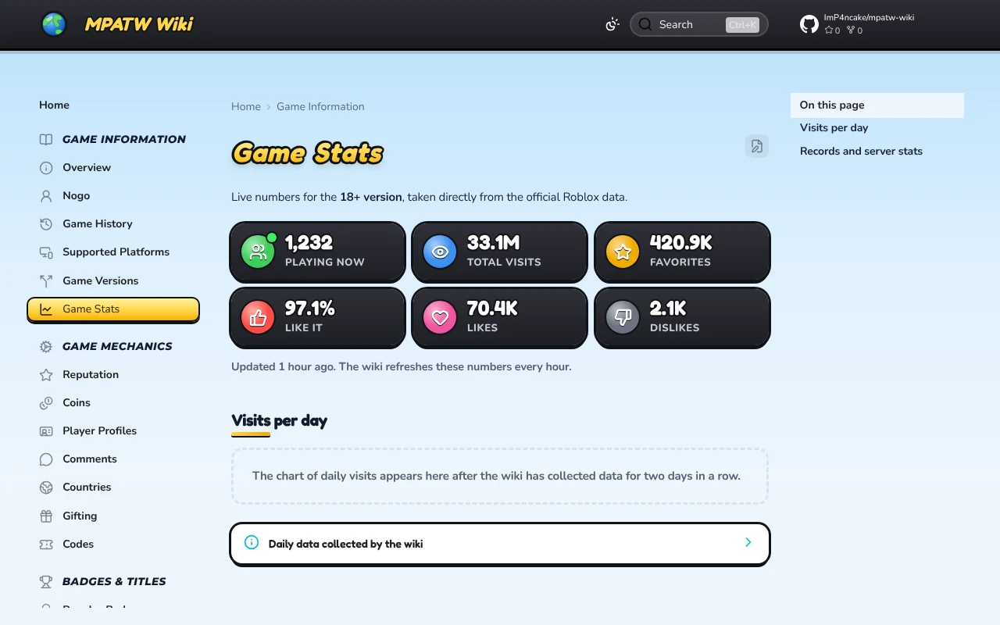

# MPATW Wiki

### The community encyclopedia for 18+ Meet People Across The World

Every badge, title, gamepass, code and event of the Roblox hangout 
where you meet people from all over the world, with live numbers straight from Roblox.

 

&nbsp;

 

 

## ✨ Highlights

<table>
<tr>
<td align="center" width="33%">
<h3>📈</h3>
<b>Live numbers</b> 
Players online, visits, favorites and likes, refreshed from Roblox every hour
</td>
<td align="center" width="33%">
<h3>🏅</h3>
<b>Every badge, ranked</b> 
From the easiest to the hardest, based on how many players own each one
</td>
<td align="center" width="33%">
<h3>📢</h3>
<b>Official updates</b> 
The developer's announcements from the game's Discord, within the hour
</td>
</tr>
<tr>
<td align="center" width="33%">
<h3>⏳</h3>
<b>Limited-time timers</b> 
Countdowns for event items before they leave the shop
</td>
<td align="center" width="33%">
<h3>🎮</h3>
<b>Looks like the game</b> 
Chunky buttons, menu tiles and the sunny sky of Meet People Across The World
</td>
<td align="center" width="33%">
<h3>📱</h3>
<b>Made for every screen</b> 
Works on phones, with light and dark mode and instant search
</td>
</tr>
</table>

## 🗺️ What's inside

<table>
<tr>
<td width="50%">📖 &nbsp;<a href="https://imp4ncake.github.io/mpatw-wiki/game-info/"><b>Game Information</b></a> The game, its creator, its history and its versions</td>
<td width="50%">⚙️ &nbsp;<a href="https://imp4ncake.github.io/mpatw-wiki/mechanics/"><b>Game Mechanics</b></a> The core systems and how they work</td>
</tr>
<tr>
<td>🏆 &nbsp;<a href="https://imp4ncake.github.io/mpatw-wiki/badges/"><b>Badges &amp; Titles</b></a> Achievements, unlockable titles and tag effects</td>
<td>🗺️ &nbsp;<a href="https://imp4ncake.github.io/mpatw-wiki/activities/"><b>Activities &amp; Locations</b></a> Minigames and interactive areas around the map</td>
</tr>
<tr>
<td>🛍️ &nbsp;<a href="https://imp4ncake.github.io/mpatw-wiki/items/"><b>Items &amp; Customization</b></a> Items, trolls, cosmetics and gamepasses</td>
<td>🖥️ &nbsp;<a href="https://imp4ncake.github.io/mpatw-wiki/servers/"><b>Servers &amp; Features</b></a> Server types, voice chat and custom servers</td>
</tr>
<tr>
<td>📅 &nbsp;<a href="https://imp4ncake.github.io/mpatw-wiki/events/"><b>Events &amp; Updates</b></a> Seasonal events, limited-time rewards and game updates</td>
<td>🛡️ &nbsp;<a href="https://imp4ncake.github.io/mpatw-wiki/community/"><b>Community &amp; Moderation</b></a> Rules, moderation and community links</td>
</tr>
<tr>
<td>🎓 &nbsp;<a href="https://imp4ncake.github.io/mpatw-wiki/guides/"><b>Guides &amp; Tutorials</b></a> Step-by-step guides for new and experienced players</td>
<td>📂 &nbsp;<a href="https://imp4ncake.github.io/mpatw-wiki/wiki/"><b>Wiki Resources</b></a> How the wiki works and how to help</td>
</tr>
</table>

## 📸 A look around

<table>
<tr>
<td width="50%"></td>
<td width="50%"></td>
</tr>
<tr>
<td align="center">The wiki menu, styled like the in-game one</td>
<td align="center">Live game stats, straight from Roblox</td>
</tr>
</table>

## 💬 Suggestions

Spotted something missing or out of date? Have an idea for a new page?
Send your suggestion to **ImP4ncake** on Discord: **`imp4ncake`** ([how to](https://imp4ncake.github.io/mpatw-wiki/wiki/suggest/)).

 

Unofficial fan project, not affiliated with or endorsed by Roblox Corporation or Nogo. 
Wiki text under <a href="https://creativecommons.org/licenses/by-sa/4.0/">CC BY-SA 4.0</a> · Site code under <a href="LICENSE">Apache 2.0</a> · <a href=".github/MAINTAINING.md">How the site is built</a>

