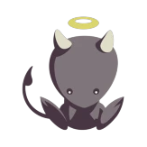

# Nogo

Nogo :lucide-badge-check: Verified group

**Nogo** is the Roblox creator behind *Meet People Across The World*. Both versions of the game are published by the **Nogo** group, which has about **916,000 members** (October 2026). The group is owned by the user **nogo**, and its description simply says that everything in it is made by Nogo.

[:lucide-users: Nogo group on Roblox](https://www.roblox.com/groups/3394697){ .mp-btn .mp-btn--blue target="_blank" rel="noopener" }

## Games by Nogo

Every public game on [Nogo's Roblox profile](https://www.roblox.com/users/149639411/profile) and in the groups Nogo owns. The two versions of *Meet People Across The World* are highlighted. The list updates automatically from Roblox.

--8<-- "generated/nogo-games.md"
