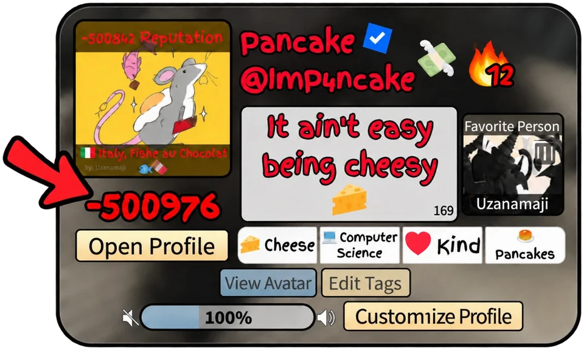

# Reputation

<b>Reputation</b> is a score that other players give you. They spend their coins on it, and it can go up or down.

:lucide-coins: 1 coin:lucide-arrow-right::lucide-thumbs-up: +1or:lucide-thumbs-down: −1

Every coin spent gives a player **1 reputation**, positive or negative.

## Where you see it

:lucide-id-card:<b>On your profile card</b>The big number under your picture

:lucide-user-round:<b>In the game</b>Under your name, with your [title](../badges/titles.md)

<figure class="mp-shot" markdown>
{ width="960" height="576" loading="lazy" }
<figcaption>The arrow points to this player's reputation: <b>−500,976</b>.</figcaption>
</figure>

## How to give reputation

:lucide-coins: Collect **coins** by playing: see [Coins](coins.md)

:lucide-users: Meet and talk to **other players**

:lucide-thumbs-up: Give them **+** or **−** reputation, and leave a [comment](comments.md) on their profile

## Good to know

:lucide-user-check:<b>You choose</b>Who gets your reputation, and whether it is positive or negative.

:lucide-coins:<b>Your coins are the only limit</b>With 1,000 coins you can give a total of +1,000 or −1,000.

:lucide-timer-off:<b>No cooldown</b>Give reputation whenever you want, to the same player too.

:lucide-trending-down:<b>It can go below zero</b>Even very far below, like the −500,976 in the picture.

!!! warning "In the rules"

    Getting or giving reputation without it costing coins, through a bug, gets you banned **and data wiped** ([c3](../community/rules.md#c3){ .mp-rule }).

## Reputation badges

<b>−10,000</b>Infamous 🤐<b>0</b><b>+10,000</b>Famous 🤩

--8<-- "generated/badge/infamous.md"

--8<-- "generated/badge/famous.md"

